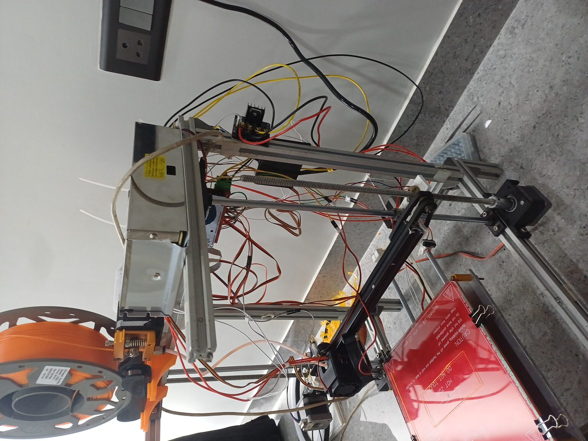
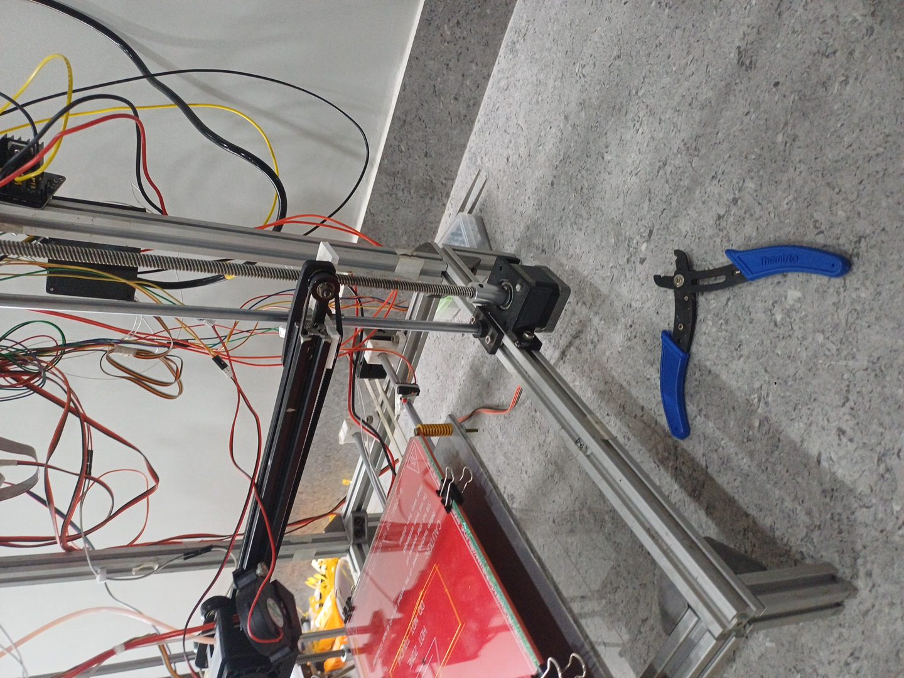
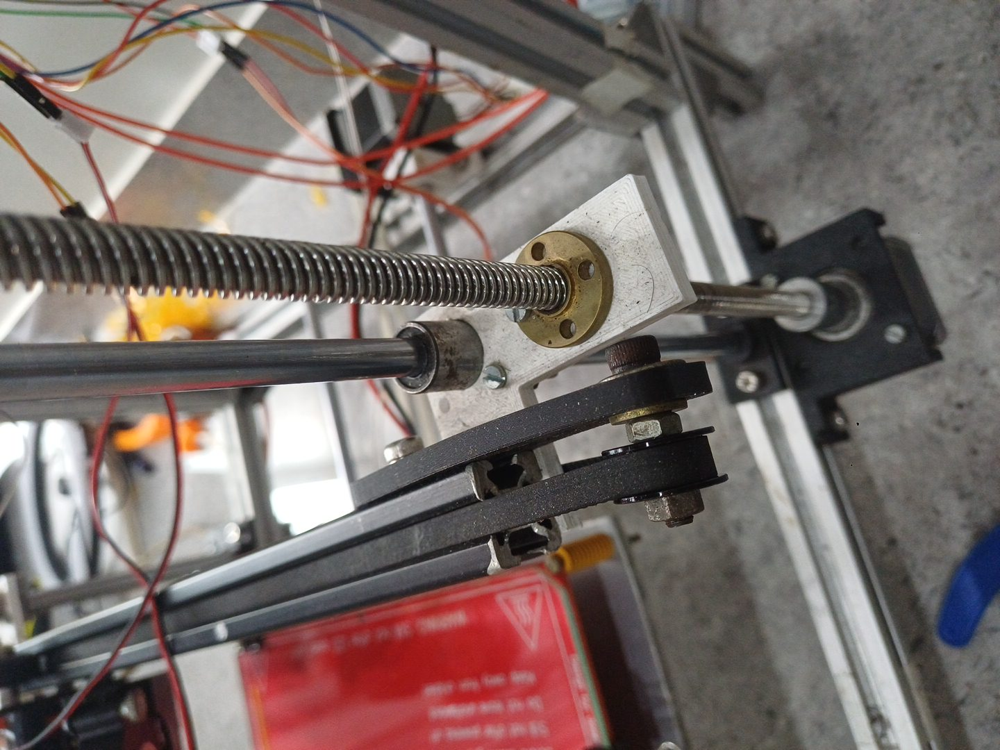
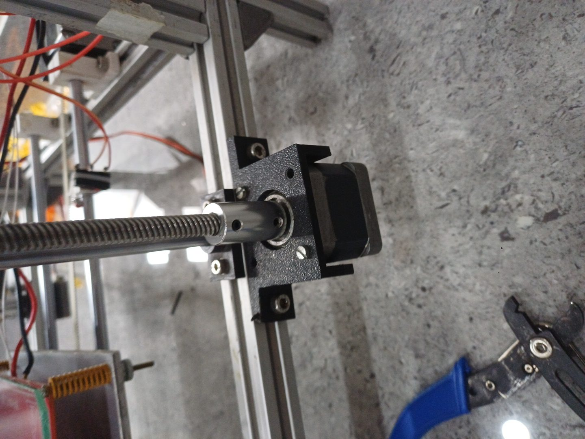
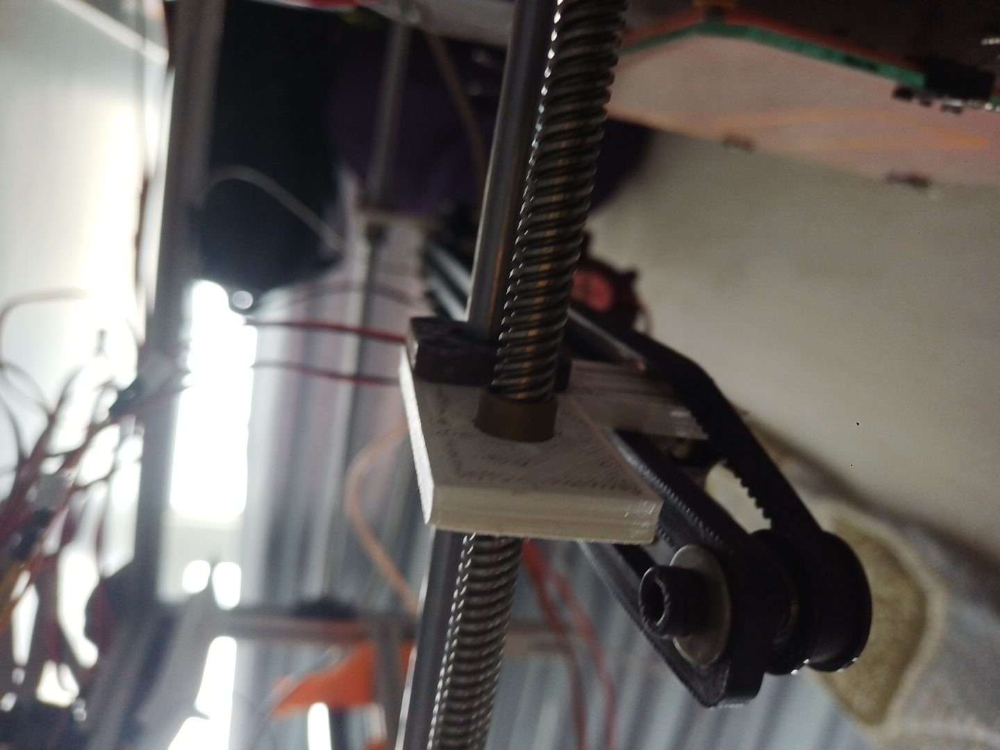
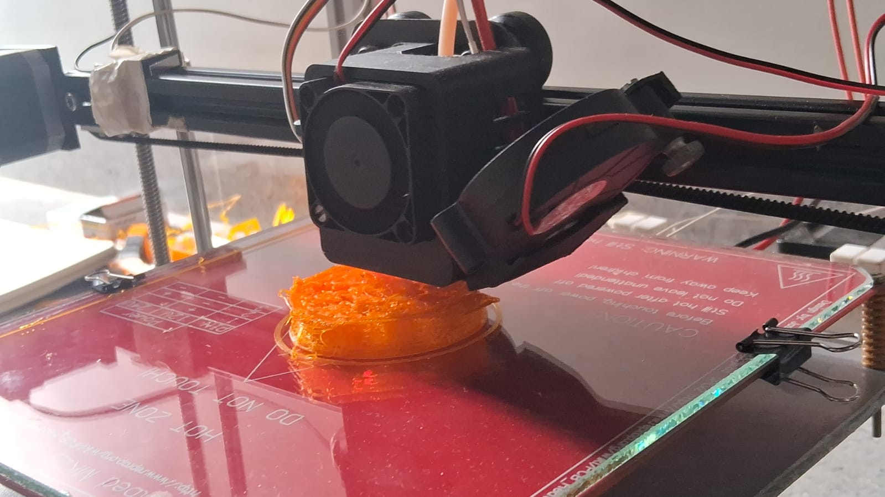
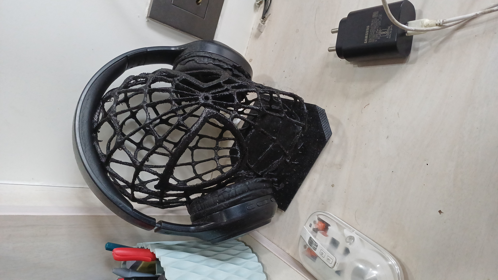
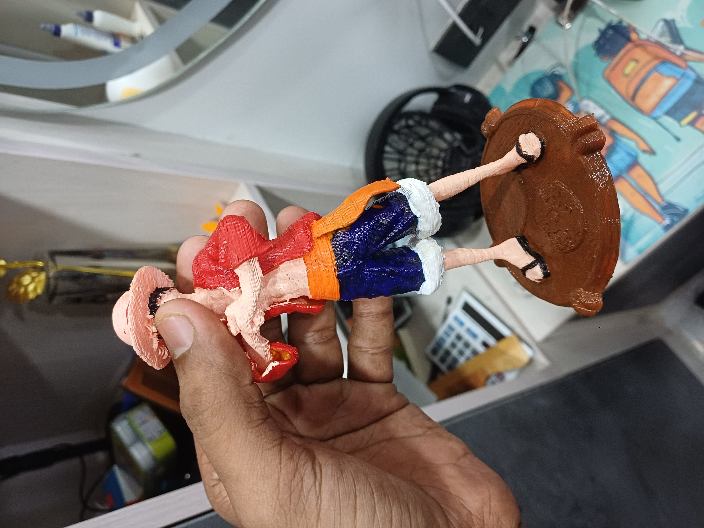

# Photo gallery

Collected from the owner's supplied files on 2026-09-12. Three individual images were copied unchanged and verified with SHA256. Five JPEGs were extracted from `Photos-1-001.zip`, retaining their filenames. Original files remain in Downloads. Captions describe visible content; filenames are not treated as verified build dates.

## Printer assembly

Overall view showing the frame, spool, frame-mounted extruder, upper power supply, bed, and gantry.

Front/right view of the bed, frame, X gantry, and right-side Z hardware.

## Mechanical details

Close-up of the X belt/idler, Z lead screw and flanged nut, smooth guide rod, and mounting plate. Exact bearing and nut materials cannot be verified from this photo.

Z motor mount and shaft-to-lead-screw coupler.

Underside view of the gantry mounting plate, lead screw nut, and idler area.

## Printhead and supplied samples

Printhead above an orange object on the glass-topped bed. The object has visibly loose strands and an uneven upper surface; the image alone does not establish the cause or whether this is a completed print.

Black openwork head-shaped stand holding headphones. The owner confirmed it was printed on this machine using PLA. Model source and print settings remain to be collected.

Figurine on a round base, with visible layer texture. The owner confirmed it was printed on this machine using PLA and painted afterward. Model source, print settings, and painting process remain to be collected.
